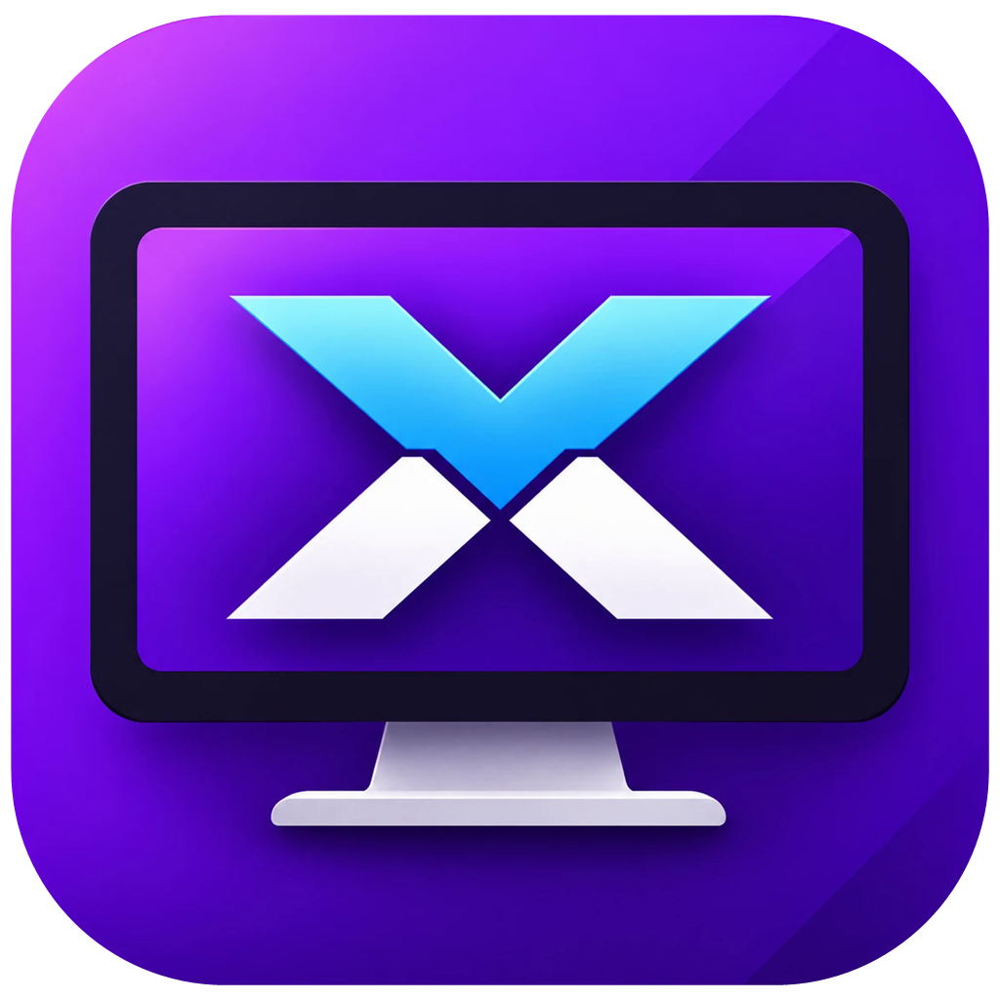
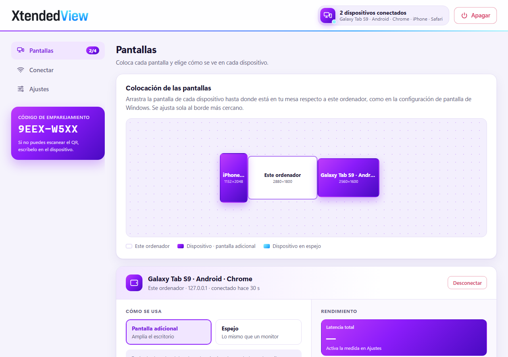
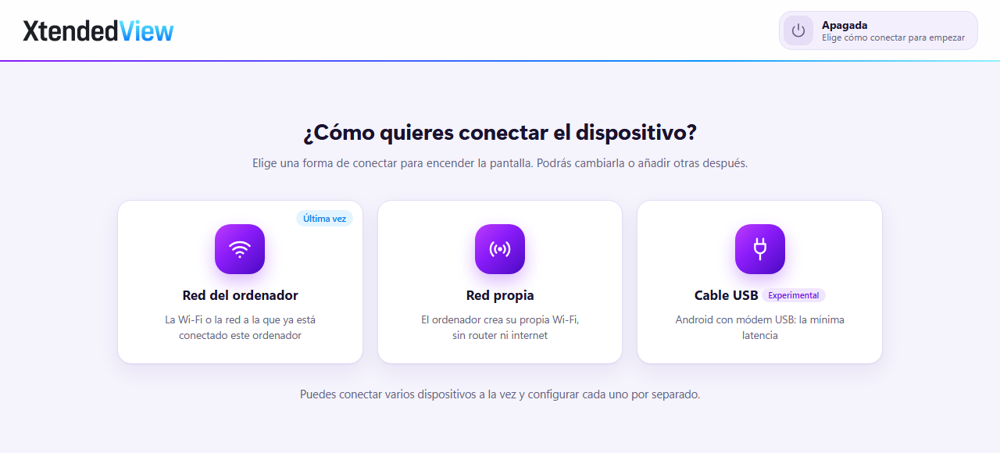
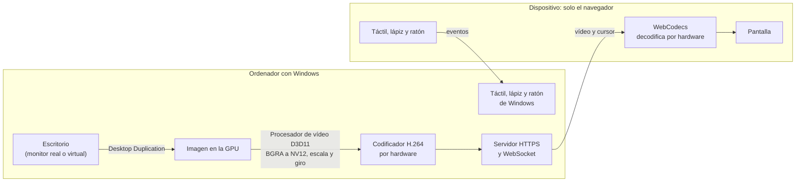

<div align="center">



<picture>
  <source media="(prefers-color-scheme: dark)" srcset="assets/logo-tema-oscuro.png">
  
</picture>

### Tu móvil, tu tablet o cualquier dispositivo con navegador, como una pantalla más de tu PC

Sin instalar nada en el dispositivo: escaneas un código QR y listo.

[](#requisitos)
[](#compilar-desde-el-código)
[](LICENSE)
[](#requisitos)

[**Descargar**](https://github.com/LuisCS-0/XtendedView/releases/latest) ·
[Cómo funciona](#cómo-funciona) ·
[Primeros pasos](#primeros-pasos) ·
[Compilar](#compilar-desde-el-código)

<br>

<picture>
  <source media="(prefers-color-scheme: dark)" srcset="docs/panel-oscuro.png">
  
</picture>

</div>

## ¿Qué es?

**XtendedView** convierte cualquier dispositivo con un navegador moderno (un móvil, una tablet, otro
portátil) en una **pantalla de tu ordenador con Windows**, al estilo de Sidecar en el Mac, pero sin
apps: el dispositivo solo abre una página web.

Puede ser **una pantalla más**, que amplía el escritorio como un monitor de verdad, o un **espejo**
de uno de tus monitores. Y no es solo para mirar: el **táctil**, el **ratón** y el **lápiz** del
dispositivo (con presión, como el S Pen o el Apple Pencil) controlan el ordenador.

Todo se maneja desde un **panel en el propio ordenador**: el dispositivo no tiene menús, solo muestra
la pantalla.

## ¿Para qué sirve?

- 🖥️ **Un segundo (o tercer) monitor** para el portátil, en casa o de viaje, con el móvil o la tablet
  que ya llevas encima.
- ✏️ **Una tableta de dibujo o de notas**: el lápiz llega a Windows con presión e inclinación, así
  que los programas de dibujo varían el trazo como con una tableta gráfica.
- 📊 **Tener a mano** el chat, la música, el correo o una herramienta mientras trabajas en la
  pantalla grande.
- ♻️ **Dar uso a ese móvil o tablet antiguos** que tienes en un cajón.

## Características

|  |  |
|---|---|
| 🌐 **Solo el navegador** | Chrome, Edge o Safari. Nada que instalar en el dispositivo. |
| 🧩 **Pantalla adicional o espejo** | Cada dispositivo como un monitor más (con su propia resolución) o duplicando uno. |
| 📱📱 **Varios a la vez** | Hasta 4 dispositivos, cada uno con sus ajustes y su forma de conectar. |
| 🧭 **Colocación como en Windows** | Arrastra cada pantalla hasta donde está en tu mesa, o colócala con un botón. |
| ✍️ **Táctil, ratón y lápiz** | Multitáctil, rueda y lápiz con presión, inclinación, botón lateral y goma. |
| ⚡ **Baja latencia** | Captura y codificación enteras en la GPU: unos 34 ms de punta a punta por cable. |
| 📶 **Tres formas de conectar** | La red de casa, una Wi-Fi propia del ordenador (sin router) o un cable USB. |
| 🌊 **Imagen más suave por Wi-Fi** | Un pequeño colchón opcional que tapa los parones de la Wi-Fi. |
| 🔍 **Tamaño de los elementos** | La escala de Windows (125 %, 150 %…) de cada pantalla, sin perder nitidez. |
| 🔒 **Seguro** | Código de emparejamiento, aceptar cada dispositivo, bloquear y certificado limitado a tu red. |
| 🪟 **Como cualquier programa** | Instalador o versión portátil, icono junto al reloj, avisos de Windows y tema claro u oscuro. |

<div align="center">
<picture>
  <source media="(prefers-color-scheme: dark)" srcset="docs/inicio-oscuro.png">
  
</picture>
</div>

## Cómo funciona



1. **Captura.** Con la API *Desktop Duplication* de Windows, el programa recibe cada imagen nueva
   del escritorio directamente en la tarjeta gráfica, solo cuando algo cambia.
2. **Pantallas virtuales.** Para usar un dispositivo como pantalla adicional, el driver gratuito
   **Parsec VDD** (de [Parsec](https://parsec.app)) crea un monitor virtual con la resolución de su
   pantalla, y Windows lo trata como un monitor más. Si el dispositivo está en vertical, el
   monitor se gira; si se pliega o se gira, se adapta solo.
3. **Conversión y codificación, sin salir de la GPU.** El procesador de vídeo de Direct3D 11 pasa la
   imagen al formato del codificador, la escala y la endereza. El codificador H.264 de la gráfica
   (Intel Quick Sync, NVIDIA NVENC o AMD AMF, a través de Media Foundation) la comprime en modo de
   baja latencia: sin B-frames y con imágenes completas solo cuando hacen falta.
4. **Envío.** El vídeo viaja cifrado por un WebSocket sobre HTTPS, por tu red local. Si el
   dispositivo se retrasa (un parón de la Wi-Fi), el ordenador espera a que se ponga al día en lugar
   de acumular retraso. El cursor va aparte, así que se mueve sin esperar al vídeo.
5. **Visor.** La página web decodifica con *WebCodecs*, usando el decodificador por hardware del
   dispositivo, y pinta cada imagen en cuanto llega.
6. **Control.** El táctil, el lápiz y el ratón del dispositivo vuelven al ordenador y se inyectan en
   Windows como los de verdad: varios dedos a la vez y un lápiz con presión, inclinación y giro.

<details>
<summary><b>Algunos detalles técnicos curiosos</b></summary>

- **El temporizador de Windows.** El codificador de Intel espera internamente con el temporizador
  del sistema, que por defecto avanza cada 15,6 ms. Pidiendo una resolución de 1 ms
  (`timeBeginPeriod`), quitando el ahorro de energía del proceso y dando prioridad multimedia al hilo
  de captura, cada imagen pasa de tardar unos 16 ms en codificarse a unos 4.
- **Una captura por monitor.** Windows solo deja duplicar cada monitor una vez por programa, así que
  si dos dispositivos muestran el mismo, comparten la captura y cada uno recibe su propia
  codificación (tamaño, fotogramas y calidad).
- **Pantallas en vertical.** El driver solo ofrece modos horizontales: para un móvil de pie se elige
  el modo con las medidas cambiadas y se gira el monitor virtual, y la imagen se endereza en la GPU
  al convertirla, sin coste extra.
- **Esperar en lugar de descartar.** Si la red se para, descartar imágenes ya codificadas rompería la
  cadena de H.264 y obligaría a mandar una imagen completa, mucho más grande, justo cuando la red va
  peor. Así que el ordenador deja de codificar para ese dispositivo hasta que se pone al día.
- **El nombre de la Wi-Fi, no.** Desde Windows 11 24H2, preguntar el nombre de la red Wi-Fi cuenta
  como usar la ubicación (y sale el aviso). El programa se apaña con las tarjetas de red y sus
  direcciones.
- **La escala de Windows por programa.** Windows no documenta cómo cambiar la escala de un monitor;
  XtendedView usa lo mismo que su propia configuración de pantalla (`DisplayConfig`, tipos -3 y -4).

</details>

## Rendimiento

Latencia de punta a punta (desde que algo se dibuja en el ordenador hasta que aparece decodificado
en el dispositivo), medida con la sonda incluida en el programa:

| Conexión | Latencia total |
|---|---|
| Cable USB (anclaje de Android) | **~34 ms** (p95 38 ms) |
| Wi-Fi de casa | 53–68 ms |

Medido con un Samsung Galaxy Z Fold y un portátil con Intel Core Ultra 7 258V (gráfica Arc 140V).
Incluye la captura, la codificación, la red y la decodificación; la pantalla del dispositivo añade
además, como mucho, un refresco.

## Requisitos

- **Ordenador:** Windows 10 u 11 de 64 bits, con una gráfica que tenga codificador H.264 por
  hardware (Intel, NVIDIA o AMD; casi todas lo tienen). Probado con Intel Arc.
- **Para usarlo como pantalla adicional:** el driver gratuito **Parsec VDD**. El instalador se ofrece
  a instalarlo; sin él, los dispositivos funcionan en modo espejo.
- **Dispositivo:** un navegador con WebCodecs: Chrome o Edge 94 o posterior (Android, Windows,
  ChromeOS…) o Safari 16.4 o posterior (iPhone, iPad).
- **Conexión:** la misma red que el ordenador, la Wi-Fi propia que crea el ordenador o, en Android,
  un cable USB.

## Instalación

Descarga la última versión desde [**Releases**](https://github.com/LuisCS-0/XtendedView/releases/latest):

- **Instalador** (`XtendedView-…-instalador.exe`). Instala el programa con su acceso en el menú
  Inicio, permite sus conexiones en el cortafuegos y, si no lo tienes, ofrece instalar también el
  driver Parsec VDD: lo descarga de la web de Parsec y solo lo ejecuta si es el instalador oficial.
  Opcionalmente, lo abre al iniciar sesión.
- **Versión portátil** (`XtendedView-…-portable.zip`). Sin instalar: descomprímela donde quieras,
  también en un USB, y abre `xtendedview.exe`. Guarda sus datos en la carpeta `datos` a su lado. La
  primera vez, Windows preguntará si dejas que use la red: acepta, también en redes públicas si vas
  a usar la red propia.

XtendedView vive junto al reloj: un clic abre el panel y, con el botón derecho, puedes salir. Al
cerrar la ventana del panel, se apaga y deja el ordenador como estaba; si prefieres que siga
funcionando en segundo plano, desactiva *Cerrar del todo al cerrar el panel* en Ajustes.

## Primeros pasos

1. **Abre XtendedView** y elige cómo conectar el dispositivo: *Red del ordenador*, *Red propia* o
   *Cable USB*. Al elegir, se enciende con un código de emparejamiento nuevo.
2. **Escanea el código QR** del panel con la cámara del dispositivo. Con la red propia hay dos: el
   primero une el dispositivo a la Wi-Fi del ordenador y el segundo abre la pantalla.
3. **La primera vez**, el navegador avisará de que la conexión no es privada, porque el certificado
   lo crea tu propio ordenador. Puedes aceptar el aviso o, mejor, **instalar el certificado** desde la
   página `/setup`, que explica cómo hacerlo en Android, iPhone y iPad.
4. **Acepta el dispositivo** en el aviso que aparece en el panel (si el panel está cerrado, te avisa
   Windows). Ahí también puedes rechazarlo o bloquearlo.
5. **Coloca su pantalla** en el plano de la sección *Pantallas*, arrastrándola o con los botones
   *Arriba*, *Abajo*, *Izquierda* y *Derecha*, y ajusta a tu gusto los fotogramas, la calidad o el
   tamaño de los elementos.

> [!TIP]
> En el navegador del dispositivo, **Añadir a pantalla de inicio** abre XtendedView a pantalla
> completa, como si fuera una app.

### Formas de conectar

| | Red del ordenador | Red propia | Cable USB *(experimental)* |
|---|---|---|---|
| **Qué es** | La Wi-Fi o la red a la que ya está conectado el ordenador | El ordenador crea su propia Wi-Fi, sin router ni internet | El anclaje USB (módem USB) de Android |
| **Ideal para** | Casa u oficina | Cualquier sitio: un tren, una cafetería… | La mínima latencia, sin tirones |
| **Dispositivos** | Todos | Todos | Android (iPad/otro PC: adaptador Ethernet, sin probar) |

Se pueden activar varias a la vez (por ejemplo, la tablet por la red propia y el móvil por cable).

## Seguridad

XtendedView está pensado para poder usarlo también fuera de casa:

- **Apagado, no entra nada:** el programa corta cualquier conexión que no venga del propio
  ordenador.
- **Código de emparejamiento** de 8 caracteres, nuevo en cada encendido, con un intento fallido por
  segundo como mucho.
- **Cada dispositivo se acepta en el panel**, aunque tenga el código, y se puede **bloquear**.
- **Solo por las conexiones activas:** con la red propia, por ejemplo, nadie de la Wi-Fi de la
  cafetería puede ni conectarse.
- **Red propia** con nombre (`DIRECT-…`) y contraseña de 16 caracteres aleatorios, nuevos cada vez:
  no dice de quién es el ordenador.
- **Todo cifrado** (HTTPS). El certificado que se instala en los dispositivos está **limitado a
  direcciones privadas**: aunque alguien robara su clave, no le serviría para suplantar ninguna web
  de internet.
- **El panel solo responde desde el propio ordenador.**

## Compilar desde el código

Hace falta [Rust](https://rustup.rs) (con las herramientas de compilación de Visual Studio, que traen
el SDK de Windows: de él sale `rc.exe`, que mete el icono en el ejecutable).

```bash
git clone https://github.com/LuisCS-0/XtendedView.git
cd XtendedView
cargo build --release --manifest-path host-rs/Cargo.toml
host-rs/target/release/xtendedview.exe
```

Desde el código, el programa abre una consola con su registro y guarda sus datos (certificados,
código y ajustes) en `certs/`, que nunca se sube al repositorio.

| Opción | Para qué |
|---|---|
| `--no-panel` | No abrir la ventana del panel al arrancar |
| `--start` | Arrancar ya encendido |
| `--hotspot` | Usar la red propia |
| `--port`, `--http-port` | Puertos HTTPS (8443) y HTTP (8080) |
| `--data <carpeta>` | Carpeta de datos |
| `--list` | Mostrar los monitores y las tarjetas de red |
| `-v` | Registro detallado |

Para generar el **instalador y la versión portátil** en `dist/` hace falta además
[Inno Setup 6](https://jrsoftware.org/isdl.php):

```bash
powershell -ExecutionPolicy Bypass -File tools/instalador.ps1
```

Las pruebas: `cargo test --manifest-path host-rs/Cargo.toml`.

<details>
<summary><b>Estructura del proyecto</b></summary>

```
host-rs/src/
  main.rs        arranque, consola o icono, una sola copia
  server.rs      HTTPS y WebSocket, panel, dispositivos, encendido y seguridad
  pipeline.rs    hilo de captura por monitor y codificador por dispositivo
  capture.rs     Desktop Duplication y cursor
  convert.rs     BGRA a NV12 en la GPU (procesador de vídeo D3D11)
  mfenc.rs       codificador H.264 por hardware (Media Foundation)
  vdd.rs         driver Parsec VDD
  display.rs     monitores virtuales: modo, posición, giro y escala
  input.rs       táctil, lápiz y ratón
  certs.rs       autoridad de certificación local
  hotspot.rs     red Wi-Fi propia (Wi-Fi Direct)
  prefs.rs       ajustes
  tray.rs        icono junto al reloj y notificaciones
  sys.rs         red, códigos QR y ventanas
web/
  index.html, viewer.js    visor del dispositivo
  panel.*                  panel del ordenador
  setup.html               instalar el certificado
  probe.*                  sonda para medir la latencia
installer/                 instalador (Inno Setup) y versión portátil
tools/                     generar el instalador, los iconos y el logotipo; resoluciones del driver
assets/                    icono y logotipo
docs/                      capturas de este README
```

</details>

## Limitaciones

- **Solo Windows.** La captura, la codificación y los monitores virtuales usan piezas exclusivas de
  Windows; llevarlo a Linux supondría rehacerlas.
- **Sin audio**, de momento.
- **Hasta 4 dispositivos** a la vez.
- **Cable:** solo Android con anclaje USB. El cable de red directo (un iPad u otro ordenador con
  adaptador Ethernet) está preparado pero sin probar.
- Probado sobre todo con un Galaxy Fold y una gráfica Intel. Con NVIDIA o AMD debería funcionar
  igual (usa el codificador que ofrezca Windows), pero no está probado.

## Licencia

[MIT](LICENSE). Puedes usarlo, copiarlo, modificarlo y distribuirlo libremente, también en otros
proyectos, conservando el aviso de autoría.

El driver Parsec VDD es de [Parsec](https://parsec.app) y tiene su propia licencia: no se incluye en
XtendedView, cada usuario lo instala desde su web.
